# 🛒 Retail Sales: Exploratory Data Analysis (SQL)

📂 Part of my portfolio: [github.com/teejay-data-io](https://github.com/teejay-data-io)

**Exploring 1,000,000 retail sales transactions with SQL to answer core business questions on revenue, products, customers, stores, seasonality and marketing.**


📄 **Full script:** [`retail_sales_analysis.sql`](retail_sales_analysis.sql) · 📈 **Companion Power BI dashboard:** [Retail Sales Analytics](https://github.com/teejay-data-io/retail-sales-powerbi-dashboard)

---

## 🔍 Overview

This project is the SQL side of my retail sales analysis. I loaded the data into MySQL, then wrote queries to profile the data, calculate KPIs and answer business questions before building the dashboard in Power BI.

**Dataset:** 1,000,000 sales transactions in a star schema:

| Table | Type | Contents |
|---|---|---|
| `fact_saless_denorm` | Fact | One row per sale: date, amount, customer, product, store, salesperson and campaign keys, plus segment, category and store type |
| `dim_customers` | Dimension | Customer segment and residential location |
| `dim_products` | Dimension | Product name, category and brand |
| `dim_stores` | Dimension | Store type and location |
| `dim_salespersons` | Dimension | Salesperson role |
| `dim_campaigns` | Dimension | Campaign name and budget |

> The fact table is named `fact_saless_denorm` (as created in the script). All queries and results below use that name.

## 📦 Dataset

**Source:** [Retail Store Star Schema Dataset](https://www.kaggle.com/datasets/shrinivasv/retail-store-star-schema-dataset) on Kaggle (by shrinivasv)

The CSV files for this project are stored once, in my [Retail Sales Power BI repository](https://github.com/teejay-data-io/retail-sales-powerbi-dashboard), and are shared with the Power BI dashboard:

| Table | CSV file |
|---|---|
| `dim_customers` | [`dim_customers.csv`](https://github.com/teejay-data-io/retail-sales-powerbi-dashboard/blob/main/dim_customers.csv) |
| `dim_products` | [`dim_products.csv`](https://github.com/teejay-data-io/retail-sales-powerbi-dashboard/blob/main/dim_products.csv) |
| `dim_stores` | [`dim_stores.csv`](https://github.com/teejay-data-io/retail-sales-powerbi-dashboard/blob/main/dim_stores.csv) |
| `dim_salespersons` | [`dim_salespersons.csv`](https://github.com/teejay-data-io/retail-sales-powerbi-dashboard/blob/main/dim_salespersons.csv) |
| `dim_campaigns` | [`dim_campaigns.csv`](https://github.com/teejay-data-io/retail-sales-powerbi-dashboard/blob/main/dim_campaigns.csv) |
| `fact_saless_denorm` | `fact_saless_denormalized.csv`: not included in this repository because of its size (1,000,000 rows). Download the full dataset from [Kaggle](https://www.kaggle.com/datasets/shrinivasv/retail-store-star-schema-dataset) (the file there is named `fact_sales_denormalized.csv`) |

## 🛠️ Tools & SQL techniques

- **MySQL 8.0** and **MySQL Workbench**
- `LOAD DATA LOCAL INFILE` for the bulk load
- Aggregations (`COUNT`, `SUM`, `AVG`, `STDDEV`), `GROUP BY` and `ORDER BY`
- `CASE` expressions for bucketing and quarters
- Subqueries, derived tables and `CROSS JOIN` for percentage shares
- Self-join with `PERIOD_DIFF` for month-over-month growth
- `JOIN`s between the fact and dimension tables
- Date functions: `DATE_FORMAT`, `HOUR`, `MONTH`

---

## ❓ Business questions & findings

### 📊 1. Data overview & KPIs

#### Store dimension preview

**What does the store data look like?**

```sql
SELECT *
FROM dim_stores;
```

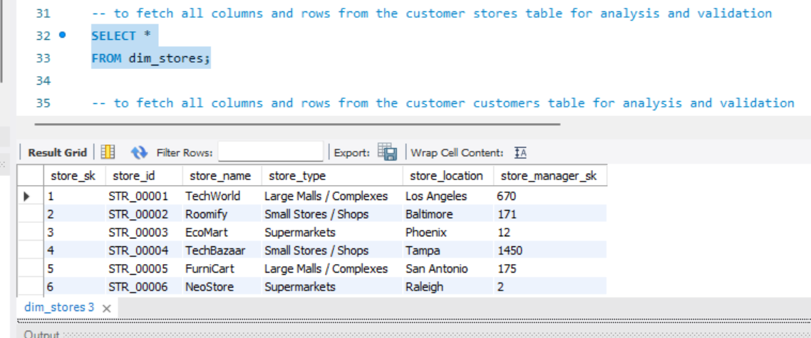

💡 `dim_stores` holds each store's type, city and manager key, the store dimension used in the store analysis below.

#### Customer dimension preview

**What does the customer data look like?**

```sql
SELECT *
FROM dim_customers;
```

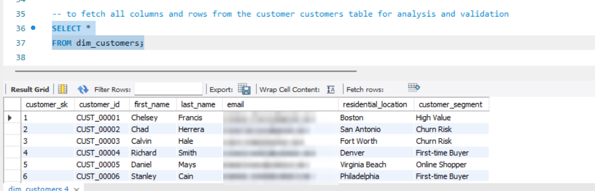

💡 `dim_customers` holds each customer's segment and residential location, used for the customer analysis. The email column is blurred in this screenshot for privacy.

#### Summary statistics of transaction amounts

**What is the range and spread of transaction values?**

```sql
SELECT
COUNT(*) AS n,
MIN(total_amount) AS min_amount,
MAX(total_amount) AS max_amount,
ROUND(AVG(total_amount),2) AS mean_amount,
ROUND(STDDEV(total_amount),2) AS stddev_amount,
ROUND(SUM(total_amount), 2) AS total_revenue
FROM fact_saless_denorm;
```

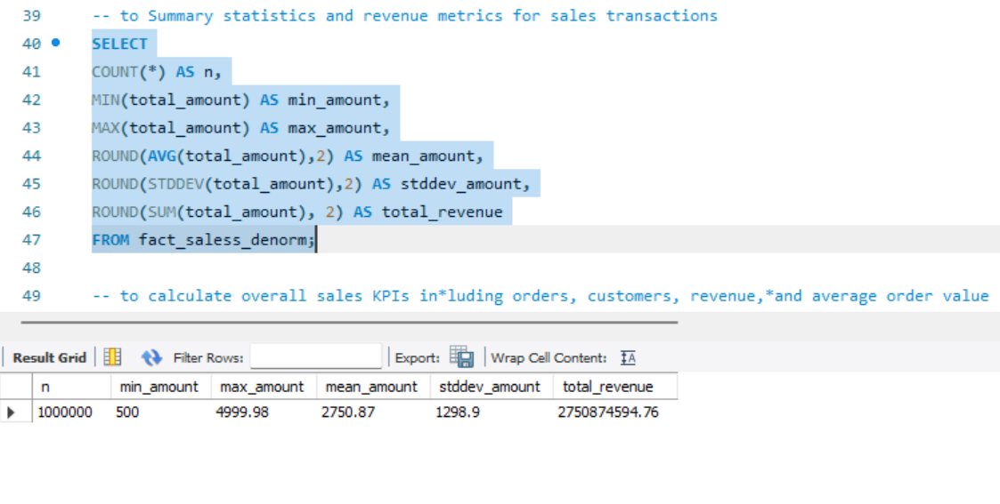

💡 1,000,000 transactions ranging from 500 to 4,999.98, with a mean of 2,750.87, a standard deviation of 1,298.9 and total revenue of 2,750,874,594.76.

#### Overall sales KPIs

**How is the business performing overall?**

```sql
SELECT
COUNT(*) AS total_orders,
COUNT(DISTINCT customer_sk) AS unique_customers,
ROUND(SUM(total_amount), 2) AS total_revenue,
ROUND(AVG(total_amount), 2) AS avg_order_value
FROM fact_saless_denorm;
```

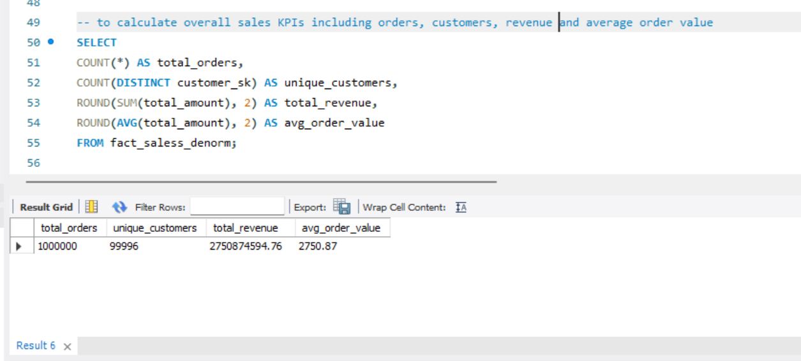

💡 1,000,000 orders from 99,996 unique customers generated 2,750,874,594.76 in revenue, an average order value of 2,750.87.

#### Size of each dimension

**How many categories, brands, segments and locations are in the data?**

```sql
SELECT
(SELECT COUNT(DISTINCT category) FROM dim_products) AS n_categories,
(SELECT COUNT(DISTINCT brand) FROM dim_products) AS n_brands,
(SELECT COUNT(DISTINCT customer_segment) FROM dim_customers) AS n_segments,
(SELECT COUNT(DISTINCT store_type) FROM dim_stores) AS n_store_types,
(SELECT COUNT(DISTINCT store_location) FROM dim_stores) AS n_store_locations,
(SELECT COUNT(DISTINCT residential_location) FROM dim_customers) AS n_customer_locations;
```

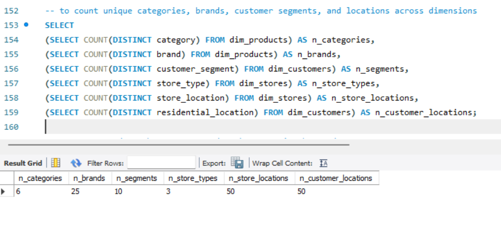

💡 The model covers 6 categories, 25 brands, 10 customer segments, 3 store types, 50 store locations and 50 customer locations.

### 🛍️ 2. Products & categories

#### Revenue by product category

**Which categories bring in the most revenue?**

```sql
SELECT 
category,
COUNT(*) AS orders,
ROUND(SUM(total_amount), 2) AS revenue,
ROUND(AVG(total_amount), 2) AS avg_order_value
FROM fact_saless_denorm
GROUP BY category
ORDER BY revenue DESC;
```

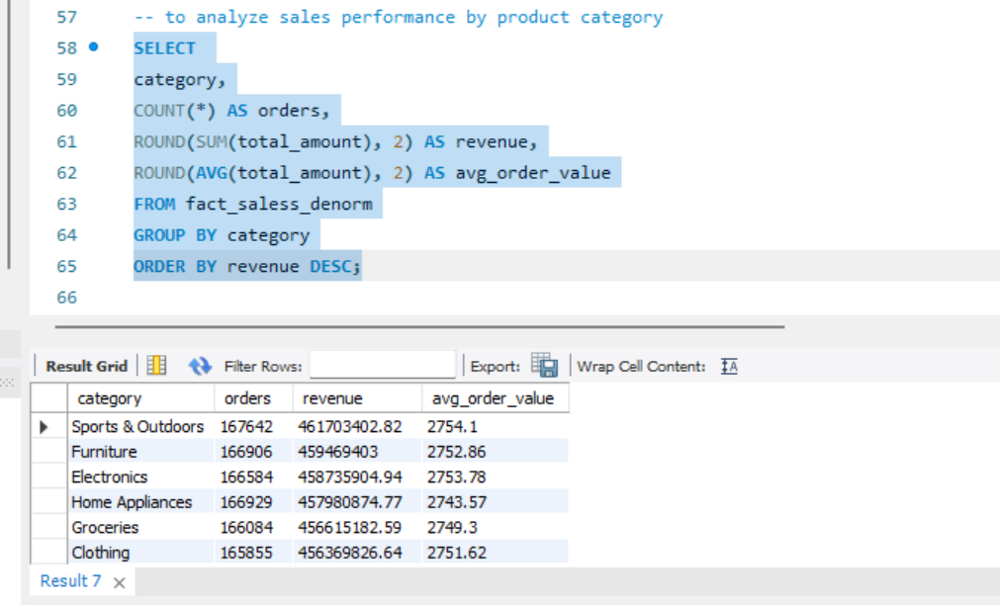

💡 Sports & Outdoors leads with 461,703,402.82 in revenue from 167,642 orders, but the gap to the last category, Clothing (456,369,826.64), is only about 5.3M.

#### Products per category

**How many products does each category carry?**

```sql
SELECT category, COUNT(*) AS n_products
FROM dim_products
GROUP BY category
ORDER BY n_products DESC;
```

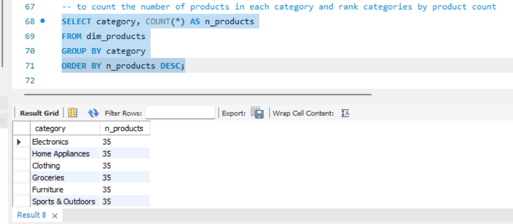

💡 Every category carries exactly 35 products, so differences in category revenue are not driven by range size.

#### Top 10 products by revenue

**Which products earn the most?**

```sql
SELECT p.product_name, p.category, COUNT(*) AS n_sold, ROUND(SUM(f.total_amount),2) AS revenue
FROM fact_saless_denorm f JOIN dim_products p ON f.product_sk = p.product_sk
GROUP BY p.product_name, p.category
ORDER BY revenue DESC
LIMIT 10;
```

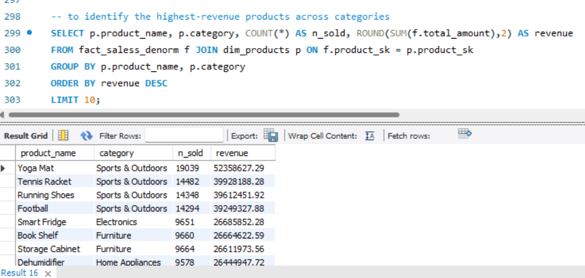

💡 Yoga Mat is the top product at 52,358,627.29 (19,039 sold), and the top four products are all Sports & Outdoors, which explains that category's lead.

#### Top brands by revenue

**Which brands earn the most?**

```sql
SELECT p.brand, COUNT(*) AS n_transactions, ROUND(SUM(f.total_amount),2) AS revenue
FROM fact_saless_denorm f JOIN dim_products p ON f.product_sk = p.product_sk
GROUP BY p.brand
ORDER BY revenue DESC
LIMIT 15;
```

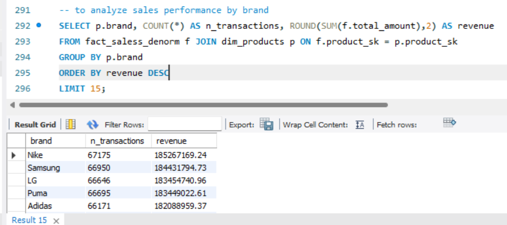

💡 Nike is the top brand at 185,267,169.24, followed closely by Samsung (184,431,794.73) and LG (183,454,740.96).

#### Transactions by order size

**How is revenue split across order sizes?**

```sql
SELECT
CASE
WHEN total_amount < 100 THEN '01: <100'
WHEN total_amount < 500 THEN '02: 100-499'
WHEN total_amount < 1000 THEN '03: 500-999'
WHEN total_amount < 2000 THEN '04: 1000-1999'
WHEN total_amount < 3000 THEN '05: 2000-2999'
ELSE '06: 3000+'
END AS amount_bucket,
COUNT(*) AS n_transactions,
ROUND(SUM(total_amount),2) AS bucket_revenue
FROM fact_saless_denorm
GROUP BY amount_bucket
ORDER BY amount_bucket;
```

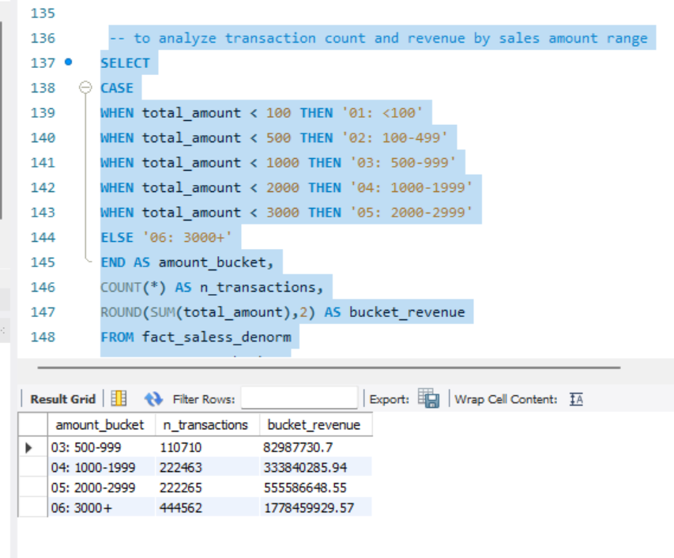

💡 No transaction is below 500. The 3000+ bucket has 444,562 transactions and 1,778,459,929.57 in revenue, about 65% of total revenue.

### 👥 3. Customers & segments

#### One-time vs repeat buyers

**How many customers buy once vs. come back?**

```sql
SELECT
orders_per_customer,
COUNT(*) AS n_customers
FROM (
SELECT
customer_sk,
COUNT(*) AS orders_per_customer
FROM fact_saless_denorm
GROUP BY customer_sk
) customer_orders
GROUP BY orders_per_customer
ORDER BY orders_per_customer;
```

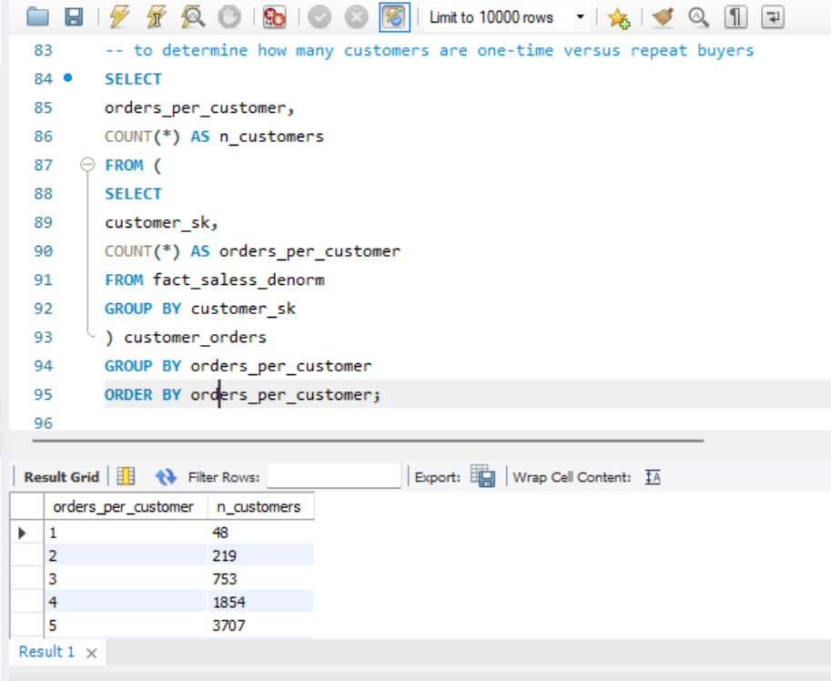

💡 Very few customers bought only once: 48 customers have a single order, 219 have two, and the counts keep rising (3,707 customers have five orders).

#### Each customer's favourite category

**What is each customer's favourite category by spend?**

<details>
<summary>Show query</summary>

```sql
SELECT
customer_sk,
category,
ROUND(category_spend, 2) AS favorite_category_spend
FROM (
SELECT
customer_sk,
category,
SUM(total_amount) AS category_spend
FROM fact_saless_denorm
GROUP BY customer_sk, category
) t
WHERE (customer_sk, category_spend) IN (
SELECT
customer_sk,
MAX(category_spend)
FROM (
SELECT
customer_sk,
category,
SUM(total_amount) AS category_spend
FROM fact_saless_denorm
GROUP BY customer_sk, category
) x
GROUP BY customer_sk
)
ORDER BY customer_sk;
```

</details>

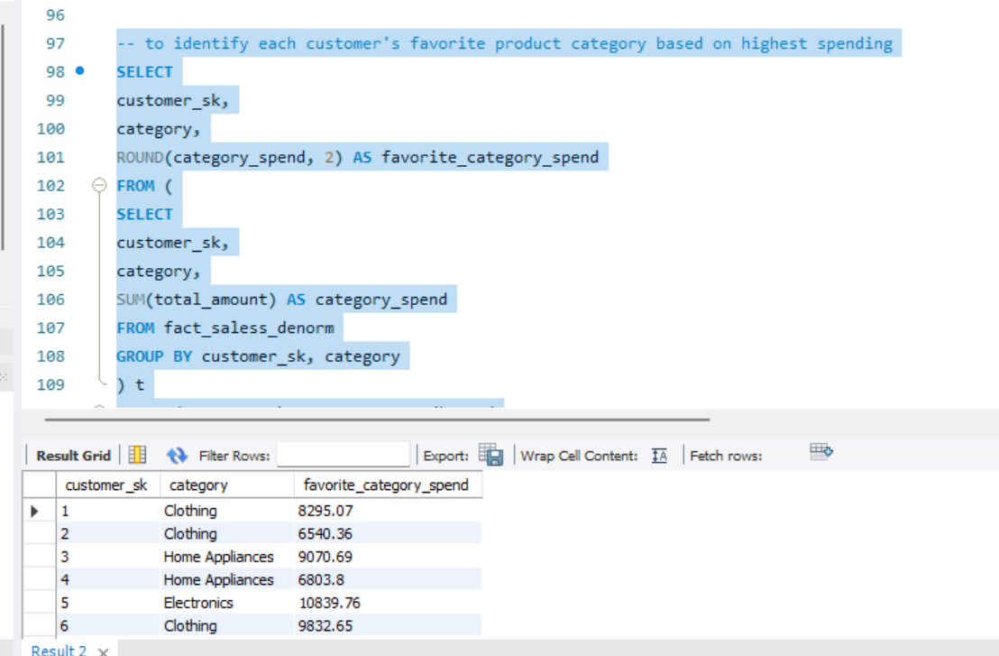

💡 Each customer's top category by spend, e.g. customer 5 spent the most on Electronics (10,839.76). The output can feed targeted, category-based marketing.

#### Revenue by customer segment

**Which customer segments are worth the most?**

```sql
SELECT
customer_segment,
COUNT(*) AS n_transactions,
ROUND(SUM(total_amount), 2) AS revenue,
ROUND(AVG(total_amount), 2) AS avg_order_value
FROM fact_saless_denorm
GROUP BY customer_segment
ORDER BY revenue DESC;
```

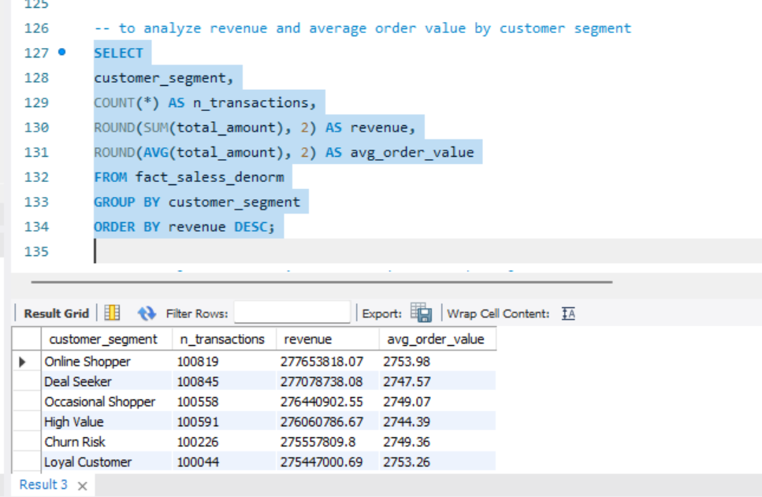

💡 Online Shopper is the top segment at 277,653,818.07, but the segments visible in the result all sit between 275.4M and 277.7M, each with about 100,000 transactions and an average order value of 2,744 to 2,754.

#### Category revenue by customer segment

**Do segments prefer different categories?**

```sql
SELECT
category,
ROUND(SUM(CASE WHEN customer_segment = 'High Value' THEN total_amount END),2) AS high_value_rev,
ROUND(SUM(CASE WHEN customer_segment = 'Loyal Customer' THEN total_amount END),2) AS loyal_rev,
ROUND(SUM(CASE WHEN customer_segment = 'Occasional Shopper' THEN total_amount END),2) AS occasional_rev,
ROUND(SUM(CASE WHEN customer_segment = 'Churn Risk' THEN total_amount END),2) AS churn_risk_rev
FROM fact_saless_denorm
GROUP BY category;
```

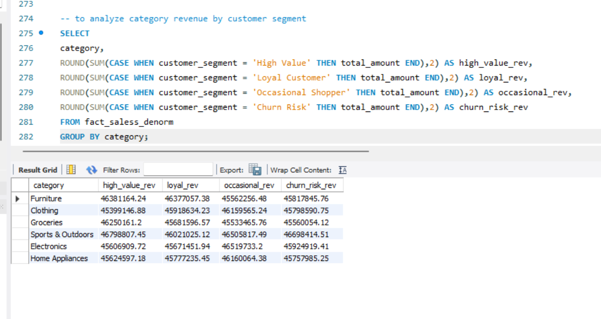

💡 Revenue per category is almost identical across the four segments analysed (about 45.4M to 46.8M per cell); the largest cell is Sports & Outdoors from High Value customers at 46,798,807.45.

### 🏬 4. Stores & sales team

#### Stores by type

**How are stores split by format?**

```sql
SELECT
 store_type, COUNT(*) AS n_stores
 FROM dim_stores 
 GROUP BY store_type
 ORDER BY n_stores DESC;
```

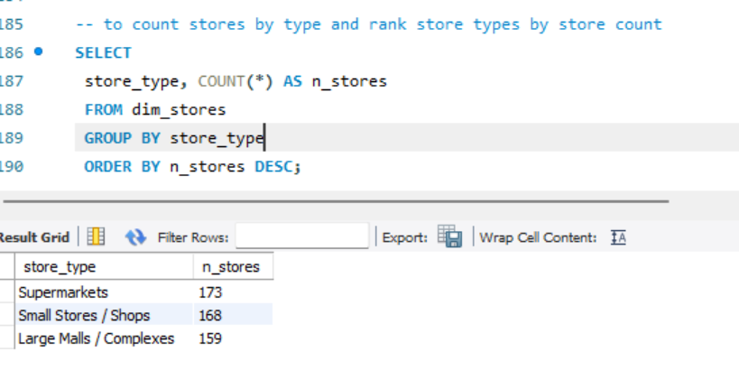

💡 500 stores in total: 173 Supermarkets, 168 Small Stores / Shops and 159 Large Malls / Complexes.

#### Top store locations

**Which cities have the most stores?**

```sql
SELECT 
store_location, COUNT(*) AS n_stores 
FROM dim_stores 
GROUP BY store_location 
ORDER BY n_stores DESC LIMIT 15;
```

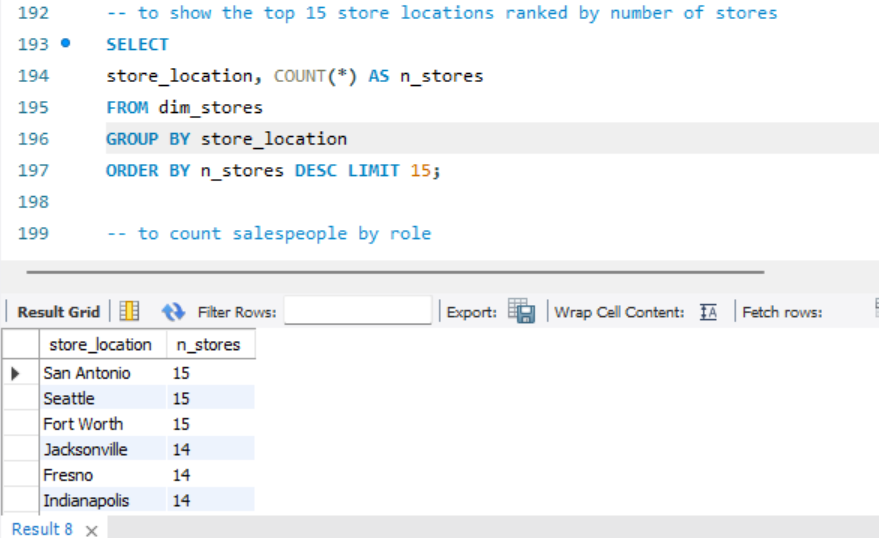

💡 San Antonio, Seattle and Fort Worth have the most stores (15 each), followed by Jacksonville, Fresno and Indianapolis (14 each).

#### Salespeople by role

**How is the sales team structured?**

```sql
SELECT 
	salesperson_role, COUNT(*) AS n_people 
FROM dim_salespersons 
GROUP BY salesperson_role;
```

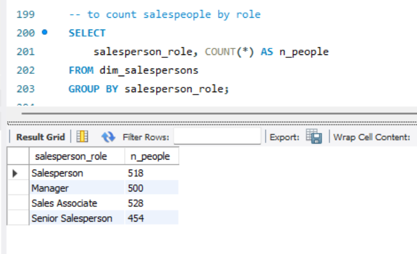

💡 2,000 sales staff: 528 Sales Associates, 518 Salespersons, 500 Managers and 454 Senior Salespersons.

#### Revenue by store type

**Which store format sells the most?**

```sql
SELECT store_type, COUNT(*) AS n_transactions, ROUND(SUM(total_amount),2) AS revenue
FROM fact_saless_denorm
GROUP BY store_type
ORDER BY revenue DESC;
```

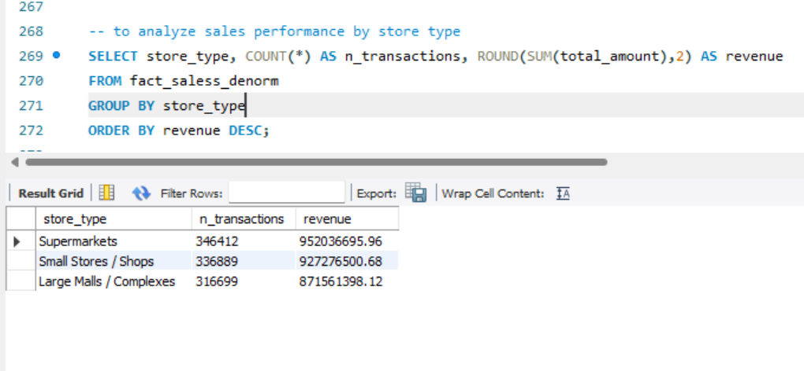

💡 Supermarkets bring in the most revenue (952,036,695.96 from 346,412 transactions), ahead of Small Stores / Shops (927.3M) and Large Malls / Complexes (871.6M), in line with their store counts.

### 📅 5. Time trends

#### Monthly revenue and average ticket

**How do revenue and ticket size move month by month?**

```sql
SELECT
DATE_FORMAT(sales_date, '%Y-%m') AS sales_month,
COUNT(*) AS n_transactions,
ROUND(SUM(total_amount),2) AS monthly_revenue,
ROUND(AVG(total_amount),2) AS avg_ticket_size
FROM fact_saless_denorm
GROUP BY sales_month
ORDER BY sales_month;
```

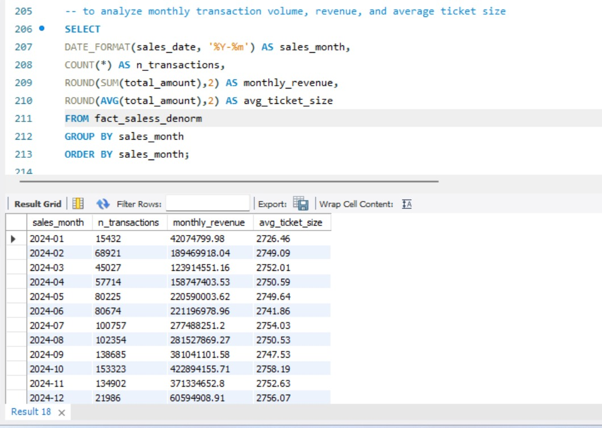

💡 Monthly revenue climbs from 42.07M in January 2024 to a peak of 422.89M in October 2024 (153,323 transactions), while the average ticket stays between 2,726 and 2,759.

#### Revenue by quarter

**Which quarter is strongest?**

```sql
SELECT
CASE
WHEN MONTH(sales_date) BETWEEN 1 AND 3 THEN 'Q1'
WHEN MONTH(sales_date) BETWEEN 4 AND 6 THEN 'Q2'
WHEN MONTH(sales_date) BETWEEN 7 AND 9 THEN 'Q3'
ELSE 'Q4'
END AS quarter,
COUNT(*) AS n_transactions,
ROUND(SUM(total_amount), 2) AS revenue
FROM fact_saless_denorm
GROUP BY quarter
ORDER BY quarter;
```

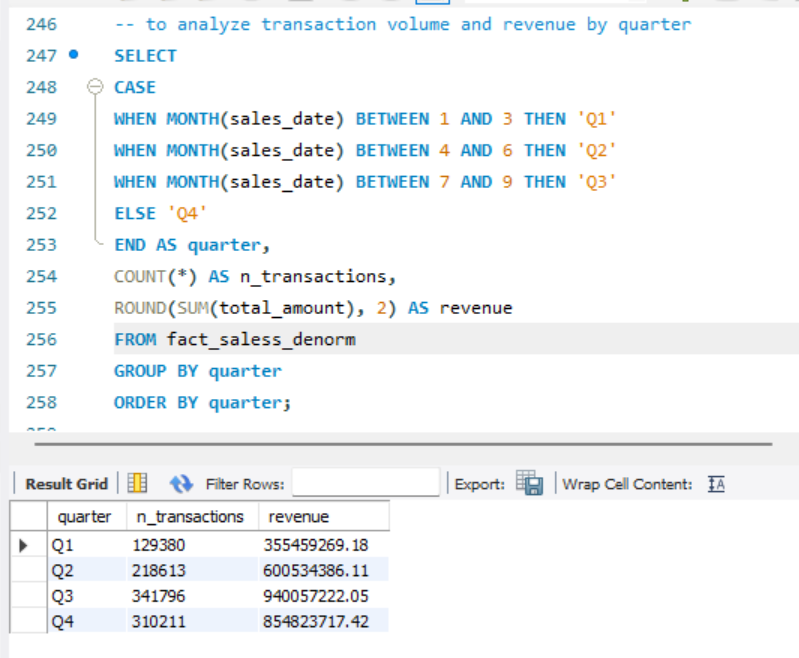

💡 Q3 is the strongest quarter at 940,057,222.05 (341,796 transactions), followed by Q4 at 854.8M; Q1 is the weakest at 355.5M.

#### Orders by hour of day

**When during the day do customers shop?**

```sql
SELECT
HOUR(sales_date) AS hour_of_day,
COUNT(*) AS total_orders,
ROUND(SUM(total_amount), 2) AS total_revenue,
ROUND(AVG(total_amount), 2) AS avg_order_value
FROM fact_saless_denorm
GROUP BY HOUR(sales_date)
ORDER BY hour_of_day;
```

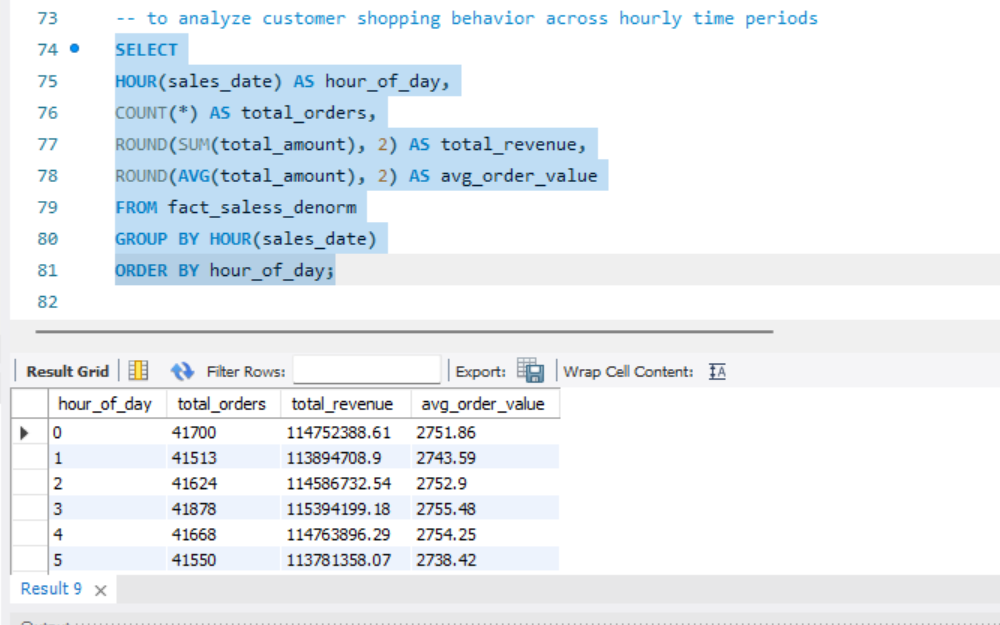

💡 Order volume is flat across the hours shown (41,513 to 41,878 orders per hour for hours 0 to 5), with average order value close to 2,750 throughout.

### 📣 6. Marketing campaigns

#### Campaign revenue and return on budget

**Which campaigns return the most revenue per budget dollar?**

```sql
SELECT cp.campaign_name, cp.campaign_budget,
COUNT(f.sales_sk) AS n_sales, ROUND(SUM(f.total_amount),2) AS revenue,
ROUND(SUM(f.total_amount) / NULLIF(cp.campaign_budget,0), 2) AS revenue_per_budget_dollar
FROM dim_campaigns cp
LEFT JOIN fact_saless_denorm f ON f.campaign_sk = cp.campaign_sk
GROUP BY cp.campaign_name, cp.campaign_budget
ORDER BY revenue DESC;
```

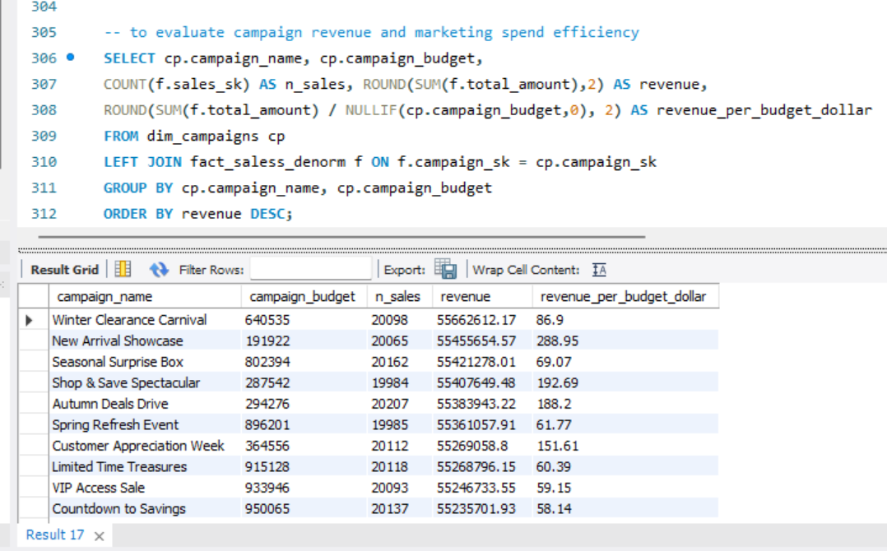

💡 Among the top 10 campaigns by revenue, each brought in about 55.2M to 55.7M from about 20,000 sales whatever its budget. New Arrival Showcase (budget 191,922) returned 288.95 per budget dollar, while Countdown to Savings (budget 950,065) returned 58.14.

---

## 🔑 Key insights

1. **Scale:** 1,000,000 orders from 99,996 customers produced 2,750,874,594.76 in revenue, an average order value of 2,750.87.
2. **Big tickets drive revenue:** orders of 3,000 and above are 444,562 transactions but about 65% of revenue.
3. **Customers come back:** only 48 customers bought once; almost everyone is a repeat buyer.
4. **Strong second half:** monthly revenue rises from 42.07M in January to 422.89M in October, and Q3 is the best quarter at 940.06M.
5. **Sports & Outdoors leads, narrowly:** it is the top category (461.7M) and holds the top four products, led by Yoga Mat (52.36M).
6. **Supermarkets sell the most:** 952.0M in revenue, in line with having the most stores (173).
7. **Campaign return depends on budget, not sales:** the top 10 campaigns all brought in about 55M each, so the cheapest ones show the best return: New Arrival Showcase made 288.95 per budget dollar vs 58.14 for Countdown to Savings.

## 📝 Notes on the data

- Revenue is very evenly spread across categories (all six between about 456M and 462M), customer segments (275.4M to 277.7M for the segments shown) and hours of the day. That pattern suggests the dataset is synthetic, so differences between groups should be read with care.
- December 2024 is much lower than other months (21,986 transactions), which looks like a partial month of data rather than a real drop.
- January 2024 is also low (15,432 transactions), so the growth through the year is partly a ramp-up in transaction volume.

---

## ▶️ How to run

1. Install **MySQL 8.0** and **MySQL Workbench**.
2. Make sure `local_infile` is allowed on both the server and the client connection (the script runs `SET GLOBAL LOCAL_INFILE=ON;`; in Workbench, add `OPT_LOCAL_INFILE=1` under the connection's *Advanced* settings).
3. Import the dimension tables (`dim_customers`, `dim_products`, `dim_stores`, `dim_salespersons`, `dim_campaigns`) into the `Retail` database. The CSV files are in the [Power BI project repository](https://github.com/teejay-data-io/retail-sales-powerbi-dashboard) (see [Dataset](#-dataset)).
4. Download the fact CSV (`fact_sales_denormalized.csv`) from the [Kaggle dataset](https://www.kaggle.com/datasets/shrinivasv/retail-store-star-schema-dataset); it is not included in this repository (see [Dataset](#-dataset)). Then, in [`retail_sales_analysis.sql`](retail_sales_analysis.sql), replace `path/to/fact_saless_denormalized.csv` with its location on your machine.
5. Run the script top to bottom, or run each query on its own to reproduce the results above.

The script also includes queries not shown above: customer share by segment, month-over-month revenue growth, and sales with vs. without a campaign.

## 📁 Folder structure

```
retail-sales-sql-eda/
├── retail_sales_analysis.sql   # full MySQL script
├── README.md                   # project summary
├── PROJECT_WRITEUP.md          # this write-up
└── images/                     # query result screenshots
```

---

## 👤 Author

**Tajudeen Olugbenga Rabiu** | Data Analyst · Power BI · SQL · Python · Excel

- 💼 LinkedIn: [linkedin.com/in/tajudeen-rabiu-data](https://www.linkedin.com/in/tajudeen-rabiu-data)
- 📧 Email: [tjrabiu.data@gmail.com](mailto:tjrabiu.data@gmail.com)
- 🌐 Portfolio: [teejay-data-io.github.io](https://teejay-data-io.github.io/)
